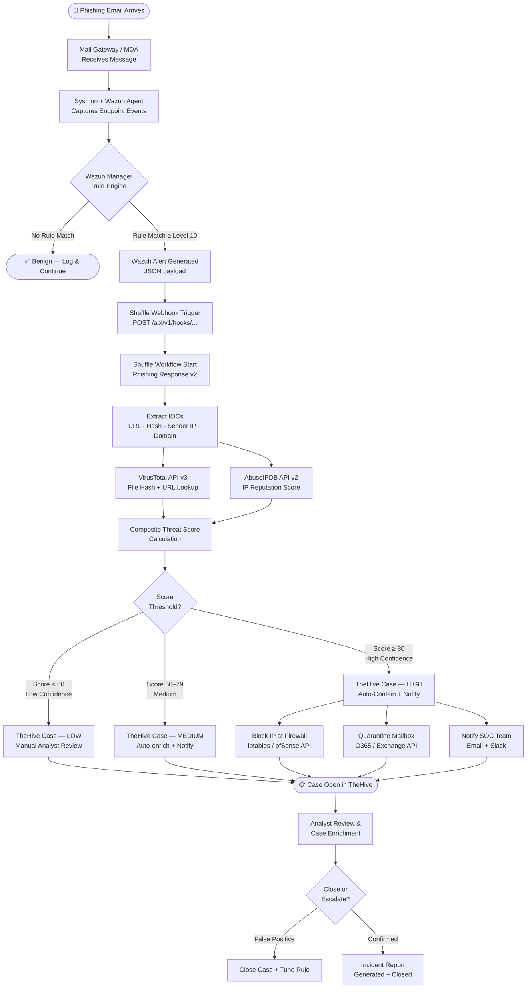
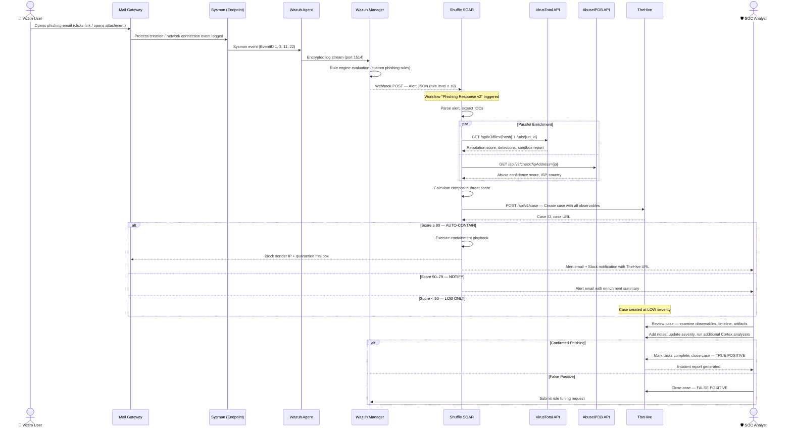
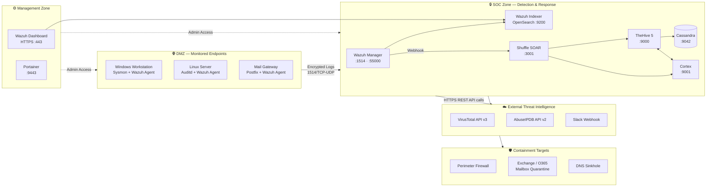

# ThreatFlow — Architecture Deep Dive

> This document describes the end-to-end technical architecture of the ThreatFlow Autonomous Phishing Response System, covering data flows, integration points, and security zone boundaries.

---

## 1. End-to-End Phishing Detection-to-Response Pipeline

---

## 2. Sequence Diagram — Full Incident Lifecycle

---

## 3. Data Flow Description by Stage

### Stage 1 — Telemetry Collection
| Input | Processor | Output |
|-------|-----------|--------|
| Email open / attachment execution | Sysmon (EventID 1, 3, 11, 22, 23) | Windows event log entries |
| Sysmon XML events | Wazuh Agent (ossec-logcollector) | Encrypted, compressed log stream |
| Raw log stream | Wazuh Manager (ossec-analysisd) | Structured JSON alert |

**Key Sysmon Event IDs monitored:**
- `1` — Process creation (macro / script interpreter launched from email client)
- `3` — Network connection (beaconing to C2 or phishing domain)
- `11` — File creation (dropped payload)
- `22` — DNS query (suspicious domain resolution)
- `23` — File deletion (artefact cleanup attempt)

---

### Stage 2 — Detection & Alerting
Wazuh Manager's rule engine evaluates every incoming log against ~3,000 built-in rules plus ThreatFlow's custom ruleset (`local_rules.xml`). A phishing alert is generated when:

- **Rule 100001** — Email client spawns PowerShell / `cmd.exe` / `wscript.exe`
- **Rule 100002** — Outbound connection to domain in phishing feed within 60 s of email open
- **Rule 100003** — LOLBin (certutil, bitsadmin, mshta) network activity post-email-open
- **Rule 100004** — Suspicious attachment extension combination (`.doc` + macro execution)

Alerts at **level ≥ 10** trigger the Shuffle webhook.

---

### Stage 3 — Orchestration (Shuffle)
The Shuffle workflow receives the Wazuh alert JSON and executes the following steps:

1. **IOC Extraction** — Regex and JQ parsing to extract: source IP, file hash (SHA256), URL, sender domain, affected hostname.
2. **Parallel Enrichment** — Simultaneous API calls to VirusTotal (file/URL) and AbuseIPDB (IP).
3. **Score Aggregation** — Weighted formula: `(VT_malicious_engines / VT_total_engines × 60) + (AbuseIPDB_score × 0.4)` → 0–100 scale.
4. **Decision Logic** — Branching based on score thresholds (< 50 / 50–79 / ≥ 80).
5. **Case Creation** — TheHive API call with full observables package attached.
6. **Containment** (if score ≥ 80) — Firewall block + mailbox quarantine + notification.

---

### Stage 4 — Case Management (TheHive)
Every incident creates a TheHive case with:
- **Severity**: Low / Medium / High (mapped from composite score)
- **Observables**: IP address, file hash, URL, domain, email address — all auto-tagged
- **Tasks**: Pre-populated from phishing case template (Triage → Containment → Eradication → Recovery)
- **Attachments**: Raw Wazuh alert JSON, VirusTotal full report, AbuseIPDB response

Cortex analyzers (VirusTotal_GetReport, AbuseIPDB, URLScan_io) can be re-run directly from the case UI.

---

### Stage 5 — Containment & Recovery
Automated containment actions (score ≥ 80):

| Action | Mechanism | Target |
|--------|-----------|--------|
| IP Block | `block_ip.py` → iptables / pfSense REST API | Perimeter firewall |
| Mailbox Quarantine | Microsoft Graph API / Exchange PowerShell | Affected mailbox |
| Hash Block | CrowdStrike / Windows Defender API | All enrolled endpoints |
| DNS Sinkhole | Infoblox / Pi-hole API | Internal DNS resolver |
| SOC Notification | SMTP + Slack Incoming Webhook | On-call analyst |

---

## 4. Integration Points

| Integration | Direction | Protocol | Auth Method | Data Exchanged |
|-------------|-----------|----------|-------------|----------------|
| Wazuh Agent → Manager | Outbound | TCP/UDP 1514 | Pre-shared key | Compressed, encrypted log events |
| Wazuh Manager → Shuffle | Outbound | HTTPS POST | Bearer token (webhook secret) | Alert JSON payload |
| Shuffle → VirusTotal | Outbound | HTTPS REST | API Key header | File hash / URL queries + reports |
| Shuffle → AbuseIPDB | Outbound | HTTPS REST | API Key header | IP check requests + reputation data |
| Shuffle → TheHive | Outbound | HTTPS REST | API Key | Case create/update, observable attach |
| Shuffle → Firewall | Outbound | HTTPS REST | API Key / SSH | IP block rule creation |
| TheHive → Cortex | Internal | HTTPS REST | API Key | Observable analysis requests + results |
| Wazuh Dashboard → Indexer | Internal | HTTPS 9200 | Username/Password | Query & aggregation |

---

## 5. Security Zones

---

*Last updated: November 2026 — ThreatFlow v2.0*

