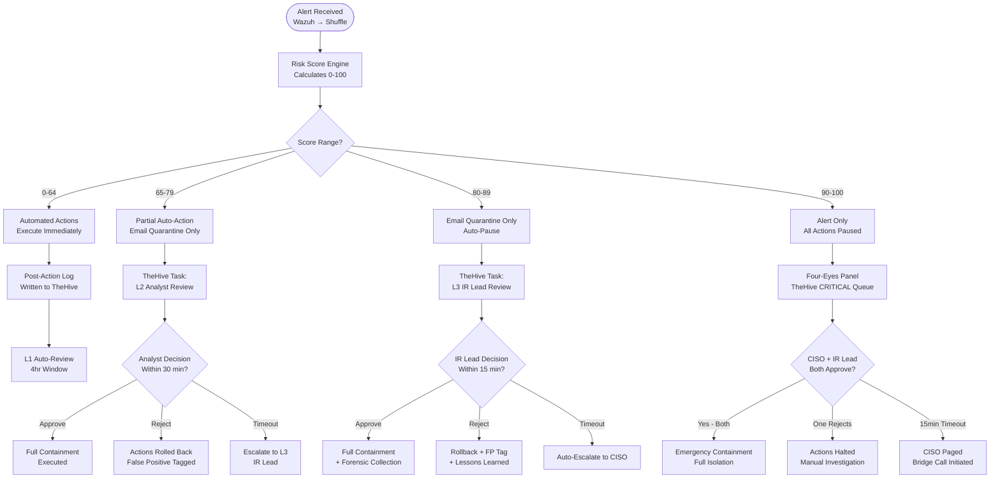
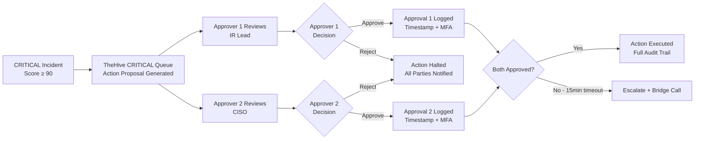

# Human-in-the-Loop (HITL) Governance Framework
**ThreatFlow Enterprise SOAR — Phishing Response**

| Field | Value |
|---|---|
| Document Version | 2.1.0 |
| Classification | INTERNAL — RESTRICTED |
| Owner | CISO / SOC Manager |
| Last Reviewed | 2026-11-13 |
| Review Cadence | Quarterly |
| Applicable Regulation | GDPR, ISO 27035, NIST SP 800-61r3 |

---

## 1. Purpose & Scope

This framework defines when and how human analysts must be involved in the ThreatFlow automated phishing response pipeline. It balances **speed of response** with **accountability, accuracy, and legal compliance**. All automated actions taken by ThreatFlow must be traceable, reversible (where possible), and proportionate to confirmed risk.

**Scope:** All incidents generated by ThreatFlow with incident type `phishing`, `credential-harvesting`, `malicious-attachment`, or `business-email-compromise`.

---

## 2. Decision Matrix — Automation vs. Human Review

| Risk Score | Severity | Auto-Action Permitted | Human Required | SLA (Analyst Response) | Approvers Needed |
|---|---|---|---|---|---|
| 0–24 | INFORMATIONAL | Log & enrich only | No | N/A | None |
| 25–44 | LOW | Auto-enrich, alert user, add to watchlist | No (notify only) | 4 hours (review) | None |
| 45–64 | MEDIUM | Auto-enrich, quarantine email, block sender | No (post-action review) | 2 hours | None (log required) |
| 65–79 | HIGH | Auto-quarantine email, isolate mailbox, block IP | **Yes — L2 Analyst** | **30 minutes** | 1 analyst |
| 80–89 | CRITICAL | Auto-quarantine only; NO isolation without approval | **Yes — L3 IR Lead** | **15 minutes** | IR Lead + L2 Analyst |
| 90–100 | CRITICAL+ | Automated actions paused; alert only | **Yes — CISO + L3** | **5 minutes** | **Four-Eyes: CISO + IR Lead** |

> [!IMPORTANT]
> Risk score 90–100 triggers the **Four-Eyes Principle** (Section 7). No containment action may be executed until two authorized signatories approve via TheHive's approval workflow.

---

## 3. Approval Workflow



---

## 4. Escalation Paths

### 4.1 Standard Escalation Chain

```
L1 Auto (Shuffle SOAR)
    │  Trigger: Risk Score 0–64, timeout, or enrichment failure
    ▼
L2 Analyst (SOC Tier 2)
    │  Trigger: Risk Score 65–79, L1 auto-escalation, or analyst override
    │  SLA: 30 minutes to decision
    ▼
L3 IR Lead (Incident Response Lead)
    │  Trigger: Risk Score 80–89, L2 timeout, confirmed breach indicator
    │  SLA: 15 minutes to decision
    ▼
CISO (Chief Information Security Officer)
    │  Trigger: Risk Score 90–100, C-suite targeting, confirmed breach
    │  SLA: 5 minutes to acknowledge (paged via PagerDuty)
    ▼
Crisis Management Team
       Trigger: Confirmed breach affecting >500 users or regulated data
       Involves: Legal, PR, DPO, Executive leadership
```

### 4.2 Escalation Triggers (Automatic)

| Trigger Condition | Escalates From | Escalates To | Method |
|---|---|---|---|
| Analyst no-response within SLA | L2 | L3 | TheHive auto-reassign + Slack ping |
| IR Lead no-response within SLA | L3 | CISO | PagerDuty P1 + SMS |
| >10 hosts affected | Any | L3 immediate | Shuffle webhook |
| C-suite mailbox targeted | L2 | CISO direct | Phone + TheHive CRITICAL |
| Regulated data exfiltration detected | Any | CISO + Legal + DPO | PagerDuty + email |
| Ransomware indicator detected | L2 | L3 + CISO immediate | All channels |

---

## 5. Override Procedures

### 5.1 Analyst Override (Halt Automation)

Any authenticated analyst may halt an automated action pipeline at any point using the **ThreatFlow Override Console** in TheHive.

**Procedure:**
1. Navigate to TheHive → Open Incident → Click **"Halt Automation"** (red button, top-right)
2. Select override reason from mandatory dropdown:
   - `FALSE_POSITIVE_CONFIRMED`
   - `BUSINESS_JUSTIFICATION` (e.g., pen test activity)
   - `EVIDENCE_PRESERVATION_REQUIRED`
   - `REGULATORY_HOLD`
   - `SYSTEM_ERROR_SUSPECTED`
3. Enter free-text justification (minimum 50 characters)
4. Click **Confirm Override** — this requires re-authentication (MFA challenge)
5. System immediately halts all queued Shuffle steps for this incident
6. Override is logged to immutable audit trail with: timestamp, analyst ID, reason, MFA confirmation

### 5.2 Emergency Global Pause

In a system-wide anomaly (e.g., Shuffle running automation against wrong scope):

```bash
# Emergency global pause — L3 or CISO only
curl -X POST https://shuffle.threatflow.internal/api/v1/workflows/pause-all \
  -H "Authorization: Bearer ${ADMIN_TOKEN}" \
  -d '{"reason": "EMERGENCY_PAUSE", "operator": "ir-lead@company.com"}'
```

This action requires CISO-level token and is logged to the SIEM.

### 5.3 Override Logging Requirements

Every override **must** generate:
- An immutable log entry in Wazuh (rule group: `threatflow_governance`)
- A TheHive comment (auto-generated by webhook)
- An email notification to SOC Manager within 5 minutes
- A ticket in the IR tracking system for post-incident review

---

## 6. Audit Requirements

### 6.1 Per-Action Logging Standard

Every automated action executed by ThreatFlow **must** produce a log entry containing:

```json
{
  "timestamp": "2026-11-13T18:30:00Z",
  "action_id": "uuid-v4",
  "incident_id": "INC-2026-847",
  "action_type": "EMAIL_QUARANTINE",
  "risk_score": 72,
  "triggered_by": "SHUFFLE_AUTO",
  "approver": null,
  "justification": "Risk score 72 exceeds HIGH threshold (65). Sender domain reputation: malicious (VT:45/90). No HITL required at this tier.",
  "affected_assets": ["user@company.com", "mailbox-id-abc123"],
  "action_result": "SUCCESS",
  "reversible": true,
  "rollback_ref": "ROLLBACK-2026-847-001",
  "audit_hash": "sha256:abc...def"
}
```

### 6.2 Audit Log Retention

| Log Type | Retention Period | Storage | Access |
|---|---|---|---|
| Automated action logs | 7 years | Immutable S3 / WORM | SOC Manager, CISO, Legal |
| Analyst decision logs | 7 years | Immutable S3 / WORM | SOC Manager, CISO, Legal |
| Override logs | 10 years | Immutable S3 / WORM | CISO, Legal, Auditors |
| Communication logs | 3 years | Encrypted archive | SOC Manager |
| Evidence packages | Case-dependent (min 3 years) | Encrypted, chain-of-custody | Legal, IR Lead |

### 6.3 Audit Review Schedule

- **Daily:** Automated review of action logs for anomalies (Wazuh rule group: audit_review)
- **Weekly:** SOC Manager reviews override log and false-positive rates
- **Monthly:** CISO reviews HITL decision quality metrics
- **Quarterly:** External review of HITL framework against compliance requirements

---

## 7. Rollback Authorization Table

| Action Type | Auto-Rollback Allowed | Requires Authorization | Rollback SLA | Method |
|---|---|---|---|---|
| Email quarantine | Yes | None | On FP confirmation | Exchange/O365 API release |
| Sender block (firewall) | Yes | L2 Analyst | 1 hour | Firewall rule delete via API |
| Mailbox access restriction | Yes | L2 Analyst | 1 hour | AD/AAD API restore |
| Host network isolation | No | **L3 IR Lead** | 2 hours | Manual + EDR console |
| Account suspension | No | **L3 IR Lead + Manager** | 4 hours | AD API + HR notification |
| DNS sinkhole | No | **L3 IR Lead** | 1 hour | DNS API + verification |
| Evidence deletion | **NEVER** | Prohibited | N/A | Requires Legal order |
| Firewall emergency block | Yes | L2 Analyst | 30 min | API + change ticket |

> [!CAUTION]
> Evidence packages and forensic artifacts are **never** subject to automated rollback. Deletion of evidence requires a formal Legal hold release and CISO written authorization.

---

## 8. Legal & Compliance Considerations

### 8.1 GDPR Data Handling

ThreatFlow processes personal data (email addresses, IP addresses, user activity logs) during phishing response. The following controls apply:

| Data Element | GDPR Basis | Retention | Encryption | Access Control |
|---|---|---|---|---|
| Email addresses | Legitimate interest (Art. 6(1)(f)) | Incident duration + 3 years | AES-256 at rest | Need-to-know |
| Email content | Legitimate interest + security | Incident duration + 3 years | AES-256 | IR team only |
| User activity logs | Legitimate interest | 1 year | AES-256 | SOC Manager |
| IP addresses | Legitimate interest | 7 years (security logs) | AES-256 | SOC |
| Forensic artifacts | Legal obligation / Vital interests | Case-dependent | AES-256, air-gapped | Legal + IR Lead |

**Data Subject Rights during Incidents:**
- Data subject access requests (DSARs) during active incident: Refer to Legal/DPO. Do not fulfill while investigation is active.
- Right to erasure: **Suspended** during active incident under Art. 17(3)(e) GDPR. DPO must be notified within 48 hours if erasure is refused.

### 8.2 Evidence Chain of Custody

All forensic evidence collected by ThreatFlow must maintain an unbroken chain of custody:

1. **Collection:** Automated collection records hash (SHA-256) of all artifacts at time of collection
2. **Storage:** Evidence stored in write-once container with access logging
3. **Transfer:** Any transfer requires documented authorization and re-hashing
4. **Preservation:** Evidence preserved in original format; no modification permitted
5. **Disposal:** Only with Legal written authorization; documented destruction certificate required

### 8.3 Cross-Border Data Transfer Restrictions

If phishing incidents involve data subjects in multiple jurisdictions:
- EU personal data must remain within EU processing zones (or SCCs in place for US transfers)
- Notify DPO before transferring evidence to law enforcement agencies
- Use ThreatFlow's evidence redaction module before sharing externally

### 8.4 Mandatory Notification Requirements

| Trigger | Notify | Deadline | Method |
|---|---|---|---|
| Personal data breach (>72hr exposure risk) | Supervisory Authority (GDPR Art. 33) | **72 hours** | DPO-managed submission |
| High-risk breach (Art. 34) | Affected data subjects | Without undue delay | Coordinated with Comms |
| Payment card data involved | PCI-DSS QSA + card brands | 24–72 hours | Via PCI IR plan |
| >500 users affected | CISO + Legal | Immediate | PagerDuty |

---

## 9. Four-Eyes Principle for CRITICAL Actions

The Four-Eyes Principle applies to all actions where Risk Score ≥ 90 or the incident involves:
- C-suite or privileged account targeting
- Confirmed data exfiltration of regulated data
- Actions affecting more than 100 users simultaneously
- Any action that cannot be automatically reversed

### 9.1 Eligible Approvers

| Role | Approval Authority | Delegation Permitted |
|---|---|---|
| CISO | Full authority | To Deputy CISO (written, 24hr max) |
| IR Lead (L3) | Operational authority | To Senior L2 during off-hours (documented) |
| Deputy CISO | Full authority (if delegated) | No sub-delegation |
| External IR Retainer | Operational authority | Only if CISO explicitly invoked retainer |

### 9.2 Four-Eyes Approval Process



### 9.3 Out-of-Hours Four-Eyes

Outside business hours (18:00–08:00 local, weekends, public holidays):
- Primary pager: On-call CISO (PagerDuty rotation)
- Secondary pager: On-call IR Lead
- If no response in 10 minutes: Escalate to Deputy CISO
- **Automatic safe-state:** If no approval within 30 minutes at CRITICAL, ThreatFlow activates **safe-state containment** (email quarantine only, no host/account actions) until human review resumes

---

## 10. Framework Review & Continuous Improvement

| Activity | Frequency | Owner | Output |
|---|---|---|---|
| Post-incident HITL review | Per major incident | IR Lead | Lessons learned ticket |
| False positive / override analysis | Weekly | SOC Manager | Weekly HITL metrics report |
| Decision matrix calibration | Quarterly | CISO + SOC Manager | Updated thresholds |
| Framework audit | Annually | External auditor | Compliance attestation |
| Tabletop exercise (HITL scenarios) | Bi-annually | IR Lead | Exercise report + updates |

---

*Document Owner: CISO | Approved by: Security Governance Board | Next Review: 2027-02-13*
