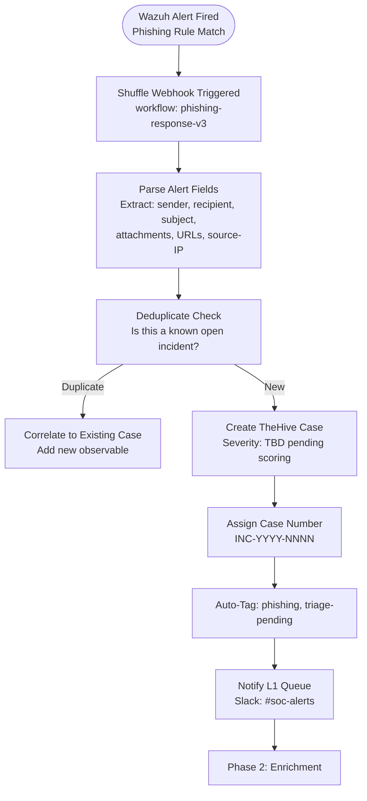
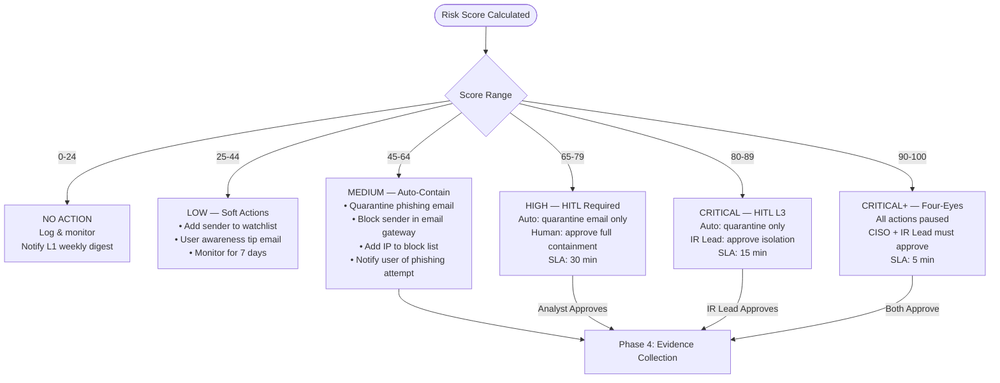

# ThreatFlow Phishing Incident Response Playbook

| Field | Value |
|---|---|
| **Playbook ID** | PB-PHISH-001 |
| **Version** | 3.0.0 |
| **Owner** | IR Lead / SOC Manager |
| **Last Reviewed** | 2026-11-13 |
| **Classification** | INTERNAL — RESTRICTED |
| **Compliance Mapping** | NIST SP 800-61r3, ISO 27035, GDPR Art. 33 |
| **Automation Level** | High (Phases 1–4 fully automated; Phases 5–6 semi/manual) |
| **Applicable Incident Types** | Phishing, Spear-phishing, BEC, Malicious Attachment, Credential Harvesting |

---

## 1. Scope & Objectives

### 1.1 Scope

This playbook governs all phishing-related incidents detected by ThreatFlow across the following environments:
- Corporate email (Microsoft 365 / Exchange)
- Endpoint telemetry (Wazuh + Sysmon)
- Web proxy alerts (suspicious URL access post-email-open)
- Threat intelligence enrichment (VirusTotal, AbuseIPDB)

**Out of Scope:** Spam filtering (handled by email gateway), social-media-based phishing (escalate to Brand Protection team), vendor account compromise (use BEC sub-playbook PB-BEC-002).

### 1.2 Objectives

| Priority | Objective | Target Metric |
|---|---|---|
| P1 | Prevent credential exfiltration | Contain within 5 min of HIGH+ detection |
| P2 | Protect affected user accounts | Restrict access within 15 min if score ≥ 65 |
| P3 | Collect court-admissible forensic evidence | 100% of HIGH+ incidents |
| P4 | Notify affected users | Within 2 hours of containment |
| P5 | Complete post-incident review | Within 5 business days |

---

## 2. Prerequisites & Integrations

| System | Role | Health Check |
|---|---|---|
| Wazuh SIEM | Primary detection & alerting | `GET /api/v2/health` → `{"status":"ok"}` |
| Shuffle SOAR | Workflow automation | Dashboard → all workflows enabled |
| TheHive | Case management & HITL | `GET /api/v1/status` → `{"status":"ok"}` |
| VirusTotal API | URL/file/IP enrichment | Quota >100 requests remaining |
| AbuseIPDB API | IP reputation | API key valid, quota available |
| Microsoft 365 API | Email quarantine & mailbox actions | OAuth token valid |
| Active Directory | Account management | LDAP connectivity confirmed |
| Sysmon | Endpoint telemetry | Agents reporting within 5 min |

---

## 3. Phase 1: Detection & Triage

**Mode:** Fully Automated
**Expected Timeline:** < 5 minutes from initial alert

### 3.1 Automated Steps



### 3.2 Triage Checklist (Automated Validation)

| Check | Expected Outcome | Action on Fail |
|---|---|---|
| Alert parsed successfully | All required fields present | Log parse error, escalate to L2 |
| Sender domain extracted | Valid domain/IP format | Use raw sender, flag for manual review |
| Deduplication query | 0 or 1 matching open case | Merge if duplicate; create new if none |
| TheHive case created | Case ID returned | Retry ×3; alert SOC Manager on fail |
| Slack notification sent | HTTP 200 from Slack API | Log warning; continue workflow |

### 3.3 Initial Auto-Tagging

ThreatFlow applies initial tags based on heuristics before full enrichment:

| Heuristic | Tag Applied |
|---|---|
| Attachment with `.hta`, `.js`, `.vbs`, `.iso` extension | `suspicious-attachment` |
| Sender domain registered <30 days ago | `new-domain` |
| Email subject contains urgency keywords | `social-engineering` |
| >10 recipients (potential mass phish) | `mass-phishing` |
| C-suite recipient detected | `vip-target` |

---

## 4. Phase 2: Enrichment & Risk Scoring

**Mode:** Fully Automated
**Expected Timeline:** < 2 minutes

### 4.1 Automated Enrichment Steps

| Step | Tool | Data Collected | Failure Fallback |
|---|---|---|---|
| Sender IP reputation | AbuseIPDB | Confidence score, country, ISP | Score as unknown (neutral) |
| Sender domain age | WHOIS API | Registration date, registrar | Flag as unverifiable |
| URL scanning | VirusTotal | Detection ratio, categories, final redirect | Queue for manual analysis |
| File hash analysis | VirusTotal | Malicious detections, behavior tags | Sandbox submit (if configured) |
| Email header analysis | Internal parser | SPF/DKIM/DMARC results, relay hops | Log anomaly |
| ASN reputation | AbuseIPDB | Known malicious ASNs | Neutral score |

### 4.2 Risk Scoring Engine

The composite risk score (0–100) is calculated as:

```
Risk Score = Σ (weight_i × score_i) / Σ weight_i

Where components are:
```

| Component | Weight | Score Range | Scoring Logic |
|---|---|---|---|
| VirusTotal detections | 30 | 0–30 | `(detected/total_engines) × 30` |
| AbuseIPDB confidence | 20 | 0–20 | `(confidence_score/100) × 20` |
| Domain age | 15 | 0–15 | `<7d=15, 7-30d=10, 30-90d=5, >90d=0` |
| SPF/DKIM/DMARC fail | 15 | 0–15 | All 3 fail=15, 2 fail=10, 1 fail=5 |
| Attachment risk | 10 | 0–10 | `.exe/.hta/.vbs=10, .js/.iso=8, .doc/.xls=5, .pdf=3` |
| VIP targeting | 5 | 0–5 | C-suite=5, Management=3, General=0 |
| Mass targeting | 5 | 0–5 | `min(recipients/10, 5)` |

### 4.3 Enrichment Output in TheHive

Each enrichment result creates a **TheHive Observable** with:
- Observable type (ip, domain, url, filename, hash)
- Reputation score and source
- Tags (`malicious`, `suspicious`, `clean`, `unknown`)
- Raw API response (attached as evidence artifact)

---

## 5. Phase 3: Containment Decision

**Mode:** Automated (score <65) or HITL (score ≥65)
**Expected Timeline:** Immediate (auto) or per HITL SLA

### 5.1 Decision Logic



### 5.2 Automated Containment Actions by Tier

#### MEDIUM (45–64) — Fully Automated

```python
# Executed by Shuffle — no human required
actions = [
    quarantine_email(message_id, mailbox),          # M365 API
    block_sender_domain(sender_domain),              # Email gateway API
    add_to_ip_blocklist(sender_ip),                  # Firewall API
    notify_user(recipient_email, template="PHISH_ALERT"),  # Comms
    update_thehive_case(status="CONTAINED", auto=True)
]
```

#### HIGH (65–79) — HITL Approval Required

Automated pre-actions (immediate):
- Email quarantine
- Logging of all observables

Pending human approval:
- Mailbox access restriction
- Block IP at perimeter firewall
- Password reset initiation
- Endpoint EDR investigation task

#### CRITICAL+ (90–100) — Four-Eyes

Automated safe-state only:
- Email quarantine
- Incident notification to CISO + IR Lead
- TheHive CRITICAL queue entry with evidence summary

All further actions: **Suspended until dual approval received**

---

## 6. Phase 4: Evidence Collection

**Mode:** Fully Automated
**Expected Timeline:** < 5 minutes (runs parallel to containment)

### 6.1 Evidence Package Contents

ThreatFlow automatically collects and packages the following for every HIGH+ incident:

| Evidence Item | Collection Method | Format | Hash |
|---|---|---|---|
| Original email (raw) | M365 EWS API | `.eml` | SHA-256 |
| Email headers | Parser | `.txt` | SHA-256 |
| Attachment files | M365 API | Original format | SHA-256 |
| URL screenshots | Headless browser | `.png` | SHA-256 |
| VirusTotal reports | VT API | `.json` | SHA-256 |
| AbuseIPDB report | AbuseIPDB API | `.json` | SHA-256 |
| Wazuh alert (raw) | Wazuh API | `.json` | SHA-256 |
| Sysmon events (endpoint) | Wazuh agent | `.evtx` / `.json` | SHA-256 |
| Memory dump (if malware exec) | EDR agent | `.dmp` | SHA-256 |
| Browser history (if URL clicked) | EDR agent | `.json` | SHA-256 |

### 6.2 Evidence Integrity Verification

```bash
# Evidence manifest generated automatically
{
  "incident_id": "INC-2026-847",
  "collection_timestamp": "2026-11-13T18:35:00Z",
  "collector": "threatflow-auto-v3.0",
  "artifacts": [
    {
      "filename": "original_email.eml",
      "sha256": "a1b2c3...",
      "size_bytes": 48392,
      "collected_at": "2026-11-13T18:35:01Z"
    }
    // ... additional artifacts
  ],
  "manifest_hash": "sha256:xyz...",
  "signed_by": "threatflow-system-key"
}
```

### 6.3 Chain of Custody Record

The evidence package is immediately:
1. Encrypted (AES-256-GCM) with incident-specific key
2. Stored in write-once evidence vault
3. Access logged to immutable audit trail
4. TheHive case updated with evidence manifest and storage location

---

## 7. Phase 5: Eradication & Recovery

**Mode:** Semi-Automated (automated execution, human verification)
**Expected Timeline:** 30 minutes – 4 hours depending on scope

### 7.1 Eradication Steps

| Step | Automated | HITL Required | Owner |
|---|---|---|---|
| Remove phishing email from all recipient mailboxes | Yes | No | Shuffle |
| Revoke active sessions for compromised accounts | Yes | No | Shuffle / AAD API |
| Reset passwords for compromised/at-risk accounts | Yes (initiated) | Analyst verifies | L2 Analyst |
| Remove malicious files from endpoints | Yes (EDR) | IR Lead confirms | EDR + L3 |
| Remove persistence mechanisms (reg keys, scheduled tasks) | No | IR Lead executes | L3 IR Lead |
| Patch exploited vulnerability (if applicable) | No | Change Management | Patch team |
| Denylist phishing domain in DNS/proxy | Yes | Analyst verifies | L2 Analyst |
| Notify upstream (CERT/ISP) if warranted | No | IR Lead | L3 IR Lead |

### 7.2 Recovery Steps

| Step | Timeline | Owner | Verification |
|---|---|---|---|
| Restore user mailbox access | After eradication confirmed | L2 Analyst | Test send/receive |
| Re-enable blocked accounts | After password reset confirmed | L2 Analyst | Login verification |
| Remove endpoint isolation | After forensic collection complete | L3 IR Lead | EDR health check |
| Update email security rules | Within 24 hours | SOC Engineer | Rule test |
| User training referral | Within 48 hours | HR / Security Awareness | Completion tracking |
| Phishing domain added to global blocklist | Immediate | Shuffle auto | Automated verification |

---

## 8. Phase 6: Post-Incident Review

**Mode:** Analyst-Driven
**Expected Timeline:** Complete within 5 business days of incident closure

### 8.1 Post-Incident Review (PIR) Agenda

1. **Timeline reconstruction** — Full attack timeline from initial phish to containment
2. **Detection effectiveness** — Was the phish detected before or after user interaction?
3. **Response time analysis** — Compare actual MTTD/MTTR against targets
4. **HITL decision quality** — Were analyst decisions correct? Any false positives?
5. **Automation gaps** — What required manual steps that could be automated?
6. **Detection gaps** — Did any indicators bypass Wazuh rules?
7. **User behaviour analysis** — Did the user click? Report? Ignore?
8. **Improvement action items** — Assign owners and deadlines

### 8.2 Metrics to Capture in PIR

| Metric | Value Captured |
|---|---|
| MTTD | Time from email delivery to Wazuh alert |
| MTTE | Time from alert to email quarantine |
| MTTR | Time from alert to full containment |
| Analyst response time | Time from HITL request to analyst decision |
| False positive? | Yes/No + reason |
| User clicked link? | Yes/No |
| Credentials entered? | Yes/No |
| Malware executed? | Yes/No |
| Lateral movement detected? | Yes/No |

---

## 9. Communication Templates

### 9.1 Internal SOC Notification

```
Subject: [ThreatFlow] Phishing Incident Detected — INC-{INCIDENT_ID} — {SEVERITY}

Incident ID: INC-{INCIDENT_ID}
Detected: {DETECTION_TIMESTAMP}
Severity: {SEVERITY}
Status: {STATUS}
Affected User(s): {AFFECTED_USERS}

Summary: A phishing email was detected targeting {RECIPIENT_EMAIL}. 
Risk Score: {RISK_SCORE}/100.
Automated containment: {AUTO_CONTAINMENT_STATUS}
Human review required: {HITL_REQUIRED}

Action required: {ACTION_REQUIRED}
TheHive Case: https://thehive.internal/cases/INC-{INCIDENT_ID}

— ThreatFlow Automated Alerting
```

### 9.2 User Notification

```
Subject: [Security Alert] Phishing Email Detected in Your Inbox

Dear {USER_NAME},

Our security systems have detected a phishing email in your mailbox and 
automatically moved it to quarantine for your protection.

What happened:
• A phishing email was sent to you from {SENDER_EMAIL}
• We detected it as malicious and quarantined it automatically
• No action is required from you at this time

{IF_CLICKED}
IMPORTANT: Our systems detected that you may have interacted with this email.
Please contact the Security team immediately at security@company.com or 
call the SOC hotline: {SOC_PHONE}
{END_IF}

Please do NOT:
• Look for this email in your trash
• Try to access any links from this sender
• Share any credentials if prompted by any recent communications

If you have questions, contact: security@company.com

Stay vigilant,
The Information Security Team
```

### 9.3 Management Brief (for CRITICAL incidents)

```
EXECUTIVE SECURITY BRIEF — CONFIDENTIAL
Incident: INC-{INCIDENT_ID} | {DATE} | {TIME}

SITUATION SUMMARY:
A {SEVERITY} phishing attack was detected targeting {TARGET_DESCRIPTION}.
ThreatFlow's automated response contained the threat within {RESPONSE_TIME} minutes.

BUSINESS IMPACT:
• Users affected: {USER_COUNT}
• Data at risk: {DATA_DESCRIPTION}
• Systems involved: {SYSTEMS_LIST}
• Business disruption: {DISRUPTION_LEVEL}

RESPONSE ACTIONS TAKEN:
1. {ACTION_1}
2. {ACTION_2}
3. {ACTION_3}

CURRENT STATUS: {CURRENT_STATUS}

NEXT STEPS:
• {NEXT_STEP_1} — Owner: {OWNER_1} — ETA: {ETA_1}
• {NEXT_STEP_2} — Owner: {OWNER_2} — ETA: {ETA_2}

REGULATORY NOTIFICATION REQUIRED: {YES/NO}
If yes, DPO notified at: {NOTIFICATION_TIME}

For further information contact: {IR_LEAD_NAME}, IR Lead, {IR_LEAD_PHONE}
```

---

## 10. Definition of Done Checklist

An incident is considered **Closed** only when ALL of the following are confirmed:

### Containment Complete
- [ ] Phishing email quarantined from all affected mailboxes
- [ ] Sender domain/IP blocked at perimeter
- [ ] All affected user sessions revoked
- [ ] Compromised accounts have new credentials
- [ ] Any malware artifacts removed from endpoints

### Evidence Complete
- [ ] Full evidence package collected and hashed
- [ ] Chain of custody documented
- [ ] Evidence stored in write-once vault
- [ ] Evidence retention period set per classification

### Notifications Complete
- [ ] Affected users notified
- [ ] Management brief sent (CRITICAL incidents only)
- [ ] Regulatory notification filed if required (GDPR 72-hour window checked)
- [ ] Threat intel shared with ISACs if applicable

### Recovery Complete
- [ ] User accounts and mailbox access restored
- [ ] Endpoint isolation lifted (after forensic sign-off)
- [ ] All temporary blocks reviewed (not over-blocking)
- [ ] Security rule updated to detect this variant in future

### Post-Incident Complete
- [ ] PIR conducted within 5 business days
- [ ] Action items logged with owners and deadlines
- [ ] MTTD/MTTR metrics recorded in dashboard
- [ ] False positive/true positive classification confirmed
- [ ] Lessons learned added to knowledge base
- [ ] Playbook updated if gaps identified

### Governance Complete
- [ ] All HITL decisions documented with justification
- [ ] Override log reviewed (if any overrides used)
- [ ] Audit trail verified as complete
- [ ] TheHive case status set to `CLOSED`

---

*Playbook Owner: IR Lead | Approved by: CISO | Next Review: 2027-02-13*
